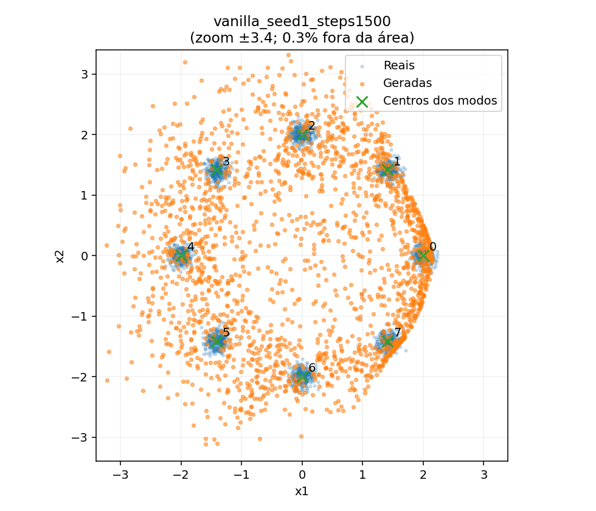
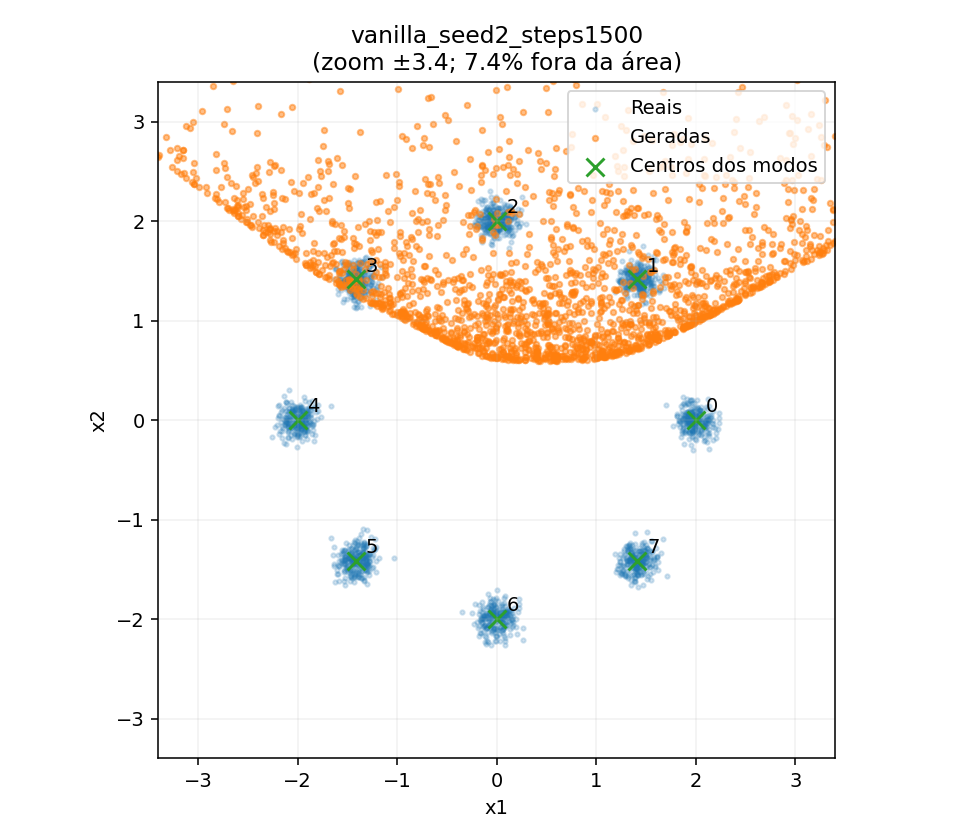
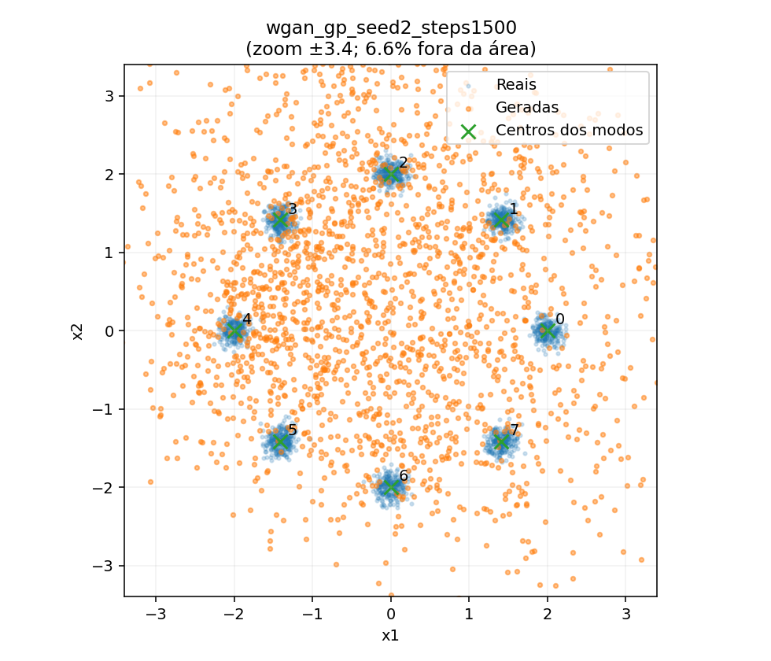

# Relatório experimental - GANs e Mode Collapse

**Disciplina:** Inteligência Artificial - PPGI/UNIRIO, 2026.2  
**Aula:** 09 · IA Generativa · 20/10/2026  
**Natureza:** laboratório didático experimental com distribuição sintética bidimensional  
**Status:** seis execuções analisadas; três sementes por modelo. Testes automatizados executados pelo responsável em Ubuntu (9 testes: `OK`).

## Resumo

Este laboratório investiga se a capacidade de gerar amostras em diferentes regiões de uma distribuição multimodal implica aprendizagem adequada da distribuição de dados. Foram treinadas uma **Vanilla GAN** e uma **WGAN-GP** sobre uma mistura uniforme de oito gaussianas bidimensionais, com três sementes e 1.500 atualizações do gerador por execução. A avaliação distingue cobertura de modos, fração de amostras próximas dos modos reais e divergência Jensen–Shannon (JS) entre frequências de ocupação **condicionadas aos pontos válidos**. A Vanilla GAN alcançou 8/8 modos em duas sementes, mas registrou somente 18,9% e 35,4% de amostras válidas; na terceira, cobriu 3/8. A WGAN-GP cobriu respectivamente 5/8, 3/8 e 7/8. A evidência demonstra a necessidade de triangulação entre métricas e de atenção à variabilidade entre execuções, sem estabelecer superioridade geral de um método.

## 1. Problema e pergunta de investigação

Modelos generativos podem produzir amostras visualmente ou geometricamente plausíveis sem reproduzir todas as regiões da distribuição original. Em GANs, isso pode manifestar-se como perda de modos (*mode dropping/collapse*); mas também podem ocorrer amostras entre os modos, que não caracterizam apenas perda de cobertura.

**Pergunta:** em uma distribuição multimodal conhecida, como Vanilla GAN e WGAN-GP se comportam quanto à **cobertura**, à **aderência aos modos reais** e ao **equilíbrio de ocupação** sob diferentes sementes de inicialização?

## 2. Objetivo e hipótese

**Objetivo:** implementar e comparar duas estratégias de treinamento adversarial e demonstrar empiricamente que nenhuma métrica isolada basta para avaliar a qualidade de uma distribuição gerada.

**Hipótese exploratória:** uma estratégia com crítico e penalização de gradiente, como a WGAN-GP, **pode** alterar a estabilidade e a cobertura dos modos, mas não garante ausência de colapso ou maior fidelidade em todas as inicializações e configurações. Não foi definida uma hipótese inferencial de superioridade estatística.

## 3. Fundamentação

- **Goodfellow et al. (2014):** formula o jogo adversarial gerador–discriminador; a convergência ao equilíbrio global é demonstrada sob condições ideais que não asseguram o comportamento em redes finitas treinadas numericamente.
- **Bond-Taylor et al. (2022):** sistematiza famílias de modelos generativos e mostra o compromisso entre qualidade, diversidade, avaliação probabilística e custo.
- **Arjovsky et al. (2017) e Gulrajani et al. (2017):** são referências **adicionais** para WGAN e sua variante com penalização de gradiente. A WGAN-GP não é contribuição do artigo original de Goodfellow.
- **Rombach et al. (2022):** oferece contexto sobre qualidade versus eficiência em geração; **modelos de difusão latente não foram implementados** neste trabalho.

## 4. Método

### 4.1. Base de dados e desenho

Distribuição-alvo: mistura uniforme de **oito gaussianas 2D** cujos centros estão sobre um círculo de raio 2, com desvio-padrão 0,1 em cada dimensão. Cada amostra é um par $(x_1,x_2)$; dados são sintetizados durante o treinamento, sem download. Essa configuração permite conhecer os oito centros e avaliar diretamente o alcance de cada modo.

**E0 (controle didático):** amostragem artificial de oito modos e amostragem artificial restrita a dois modos; **não são saídas de redes treinadas**. **E1:** Vanilla GAN. **E2:** WGAN-GP.

### 4.2. Implementação e hiperparâmetros

| Item | Vanilla GAN | WGAN-GP |
|---|---|---|
| Gerador | MLP 2–64–64–2 (ReLU) | Mesma arquitetura |
| Discriminador/crítico | MLP 2–64–64–1 (LeakyReLU) | Mesma arquitetura; saída como escore |
| Objetivo do gerador | Não saturante (logístico) | Minimização do escore negativo do crítico |
| Treinamento do avaliador | Logístico binário | Wasserstein com penalização de gradiente $\lambda=10$ |
| Otimizador | Adam, `lr=2e-4`, betas `(0.5,0.999)` | Adam, `lr=1e-4`, betas `(0.5,0.9)` |
| Atualizações do discriminador/crítico por passo do gerador | 1 | 3 |
| Passos do gerador | 1.500 | 1.500 |

Foram utilizados `batch_size=256`, `n_eval=2048`, avaliação a cada 50 passos e sementes 0, 1 e 2. O ruído de avaliação é fixo dentro de cada semente para facilitar a comparação ao longo do treinamento; o conjunto de amostras reais usado na visualização também é fixado. Execução e tempos referem-se a CPU e são dependentes do ambiente.

### 4.3. Métricas operacionais

1. **Cobertura (0–8):** cluster contado como coberto se **ao menos 1% do total gerado** estiver a distância ≤0,45 de seu centro real.
2. **Fração válida:** proporção de pontos gerados que ficam até 0,45 de algum centro.
3. **Divergência JS (bits):** diferença entre a **ocupação dos pontos válidos** e a distribuição uniforme sobre oito modos. Pontos inválidos **não entram** na distribuição de ocupação.
4. **Duração:** tempo total de execução, com custos de atualização distintos entre modelos.

As métricas são escolhidas para este problema sintético, e não equivalem a medidas universais de qualidade generativa. Em particular, **JS baixa só é informativa se lida junto à fração válida**.

### 4.4. Procedimento e rastreabilidade

Os resultados foram produzidos por `lab.py` e registrados em `results/<modelo>_seed<semente>_steps1500/`, incluindo métricas, histórico e pontos gerados. A planilha versionável [`evidencias/metricas_1500.csv`](evidencias/metricas_1500.csv) foi copiada da consolidação desses seis resultados. Para reexecutar: `python lab.py --steps 1500 --seeds 0 1 2 --force`. Os testes foram executados localmente pelo responsável, que apresentou a saída `Ran 9 tests ... OK`, e as figuras foram examinadas no Streamlit.

## 5. Resultados

### 5.1. Resultados individuais

| Seed | Modelo | Cobertura | Válidas | JS (bits) | Tempo |
|---:|---|---:|---:|---:|---:|
| 0 | Vanilla GAN | 8/8 | 18,9% | 0,012 | 3,2 s |
| 0 | WGAN-GP | 5/8 | 14,6% | 0,192 | 9,2 s |
| 1 | Vanilla GAN | 8/8 | 35,4% | 0,018 | 3,3 s |
| 1 | WGAN-GP | 3/8 | 10,5% | 0,391 | 9,1 s |
| 2 | Vanilla GAN | 3/8 | 13,5% | 0,442 | 3,3 s |
| 2 | WGAN-GP | 7/8 | 16,8% | 0,034 | 9,1 s |

### 5.2. Estatísticas descritivas

Média ± **desvio-padrão amostral** (n=3 por arquitetura):

| Métrica | Vanilla GAN | WGAN-GP |
|---|---:|---:|
| Cobertura de modos | **6,33 ± 2,89** | 5,00 ± 2,00 |
| Fração válida | **22,6% ± 11,4 p.p.** | 14,0% ± 3,2 p.p. |
| JS condicional (bits) | **0,157 ± 0,247** | 0,205 ± 0,179 |
| Duração (s) | 3,26 ± 0,02 | 9,13 ± 0,02 |

O destaque em negrito indica melhor **média descritiva nestas execuções**, não diferença estatisticamente demonstrada. Com três sementes, uma única execução pode afetar fortemente as médias.

### 5.3. Evidências visuais

**Figura 1 - Vanilla GAN, semente 1 (8/8, mas 35,4% de pontos válidos).** Cobertura ampla com numerosas amostras entre os clusters.

**Figura 2 - Vanilla GAN, semente 2 (3/8; 13,5% de pontos válidos).** Perda de cobertura, com concentração em parte da distribuição.

**Figura 3 - WGAN-GP, semente 2 (7/8; 16,8% de pontos válidos).** Cobertura mais ampla, porém grande dispersão fora dos modos reais.

Os gráficos usam zoom de ±3,4; o percentual de pontos **fora do zoom** mostrado no título das figuras é diferente da **fração inválida** definida pela distância ≤0,45.

## 6. Discussão

### 6.1. Cobertura não significa fidelidade

Na semente 1, a Vanilla GAN cobriu **8/8** modos e teve **JS=0,018**, porém somente **35,4%** das amostras foram válidas. Assim, aproximadamente **64,6%** foram geradas longe dos centros reais de acordo com o limiar adotado. A rede alcançou as regiões dos modos, mas não concentrou a maior parte da massa gerada nelas. Logo, **cobertura completa e JS condicional baixa não demonstram aprendizagem da distribuição contínua inteira**.

### 6.2. Comportamento varia conforme a semente

A Vanilla GAN cobriu 8, 8 e 3 modos (sementes 0, 1, 2). A WGAN-GP cobriu 5, 3 e 7. Na semente 1, a Vanilla foi melhor segundo os três indicadores; na semente 2, a WGAN-GP foi melhor. Não há dominância consistente ao comparar as sementes individualmente. Usar as mesmas etiquetas de semente não iguala trajetórias de otimização nem torna as condições plenamente pareadas.

### 6.3. JS condicional pode ocultar erros de geração

Na semente 2, a WGAN-GP apresentou **JS=0,034**, valor baixo entre os pontos válidos, mas **83,2%** dos pontos ficaram fora das regiões válidas. A métrica responde à **distribuição de ocupação dos pontos aceitos**, e não diretamente à fidelidade de todas as amostras. Portanto, interpretá-la isoladamente inflaria a impressão de qualidade.

### 6.4. WGAN-GP não representa uma intervenção isolada

Além da função objetivo e da penalização de gradiente, o treinamento WGAN-GP tem **três** atualizações do crítico por passo do gerador, outro *learning rate* e custo observado maior. Na semente 1, os tempos foram aproximadamente 9,1 s contra 3,3 s. Portanto, a comparação é de **configurações de treinamento**, não de uma variável causal isolada ou de eficiência sob orçamento equivalente.

### 6.5. O que se pode chamar de mode collapse?

Uma cobertura pequena (por exemplo, os 3/8 modos da Vanilla seed 2) constitui evidência operacional de **perda de cobertura**, consistente com *mode collapse*. Já um modelo que alcança 8/8, mas gera muitos pontos entre os modos, apresenta principalmente **baixa aderência** aos dados. As duas falhas podem coexistir e não devem ser confundidas.

## 7. Limitações e ameaças à validade

- **Validade externa:** mistura de oito gaussianas 2D, muito diferente de imagens complexas e textos.
- **Poder descritivo restrito:** só três sementes, sem intervalos de confiança, testes inferenciais nem busca sistemática de hiperparâmetros.
- **Confundimento:** funções objetivo, betas, taxas de aprendizagem e passos do crítico diferem; não foi isolada uma intervenção causal única.
- **Orçamento:** mesmo número de atualizações do gerador, porém custos e atualizações totais diferentes.
- **Dependência das métricas:** limiar de distância 0,45 e cobertura mínima de 1% são convenções do laboratório; outros valores mudariam os resultados.
- **Distribuição conhecida:** centros reais são fornecidos ao avaliador, o que não se generaliza automaticamente a dados reais.
- **Trajetória parcial:** avaliações discretas podem deixar passar mudanças entre checkpoints; não foi demonstrada convergência.
- **Reprodutibilidade do ambiente:** resultados numéricos e tempos podem mudar com versões de bibliotecas, dispositivo e ambiente, apesar das sementes.

## 8. Conclusão

O experimento sustenta a conclusão didática de que **cobertura, aderência à distribuição de referência e equilíbrio de ocupação são dimensões distintas**. Algumas execuções alcançam todos os oito modos enquanto a maioria das amostras permanece distante dos clusters; outras apresentam perda explícita de cobertura. A WGAN-GP não demonstrou superioridade sistemática nas configurações examinadas, e os resultados foram sensíveis à semente. O trabalho **não** autoriza afirmar que a Vanilla GAN é superior em geral, nem que uma penalização de gradiente elimina *mode collapse*. A avaliação de modelos generativos exige métricas complementares, interpretação das hipóteses de medição e desenho experimental cuidadoso.

## 9. Uso de IA e verificação

Um assistente de IA apoiou o planejamento, a implementação, a organização dos testes, a visualização e a redação do relatório. O responsável executou os **nove testes automatizados** em Ubuntu, verificou a aplicação Streamlit e compartilhou capturas dos experimentos com sementes 1 e 2. As métricas aqui relatadas foram conferidas contra os arquivos de saída incluídos no pacote; as conclusões foram limitadas ao que essas evidências sustentam. O uso de IA não substitui a responsabilidade do pesquisador por código, resultados e interpretação.

## 10. Trabalhos futuros

1. Repetir o estudo com **≥10 sementes**, mantendo protocolo pré-definido e relatando incerteza.
2. Comparar arquiteturas sob **tempo de treinamento ou número total de atualizações** equivalentes.
3. Variar uma configuração por vez, como taxa de aprendizagem, `n_critic` ou penalização.
4. Verificar sensibilidade ao raio de validade (0,30; 0,45; 0,60), mantendo explícita a mudança de critério.
5. Experimentar métricas adicionais que penalizem amostras fora das regiões reais e comparem a geometria geral.

## Referências

- GOODFELLOW, I. et al. *Generative Adversarial Nets*. NeurIPS, 2014.
- BOND-TAYLOR, S. et al. *Deep Generative Modelling: A Comparative Review of VAEs, GANs, Normalizing Flows, Energy-Based and Autoregressive Models*. IEEE TPAMI, 2022.
- ROMBACH, R. et al. *High-Resolution Image Synthesis with Latent Diffusion Models*. CVPR, 2022.
- ARJOVSKY, M.; CHINTALA, S.; BOTTOU, L. *Wasserstein Generative Adversarial Networks*. ICML, 2017.
- GULRAJANI, I. et al. *Improved Training of Wasserstein GANs*. NeurIPS, 2017.
